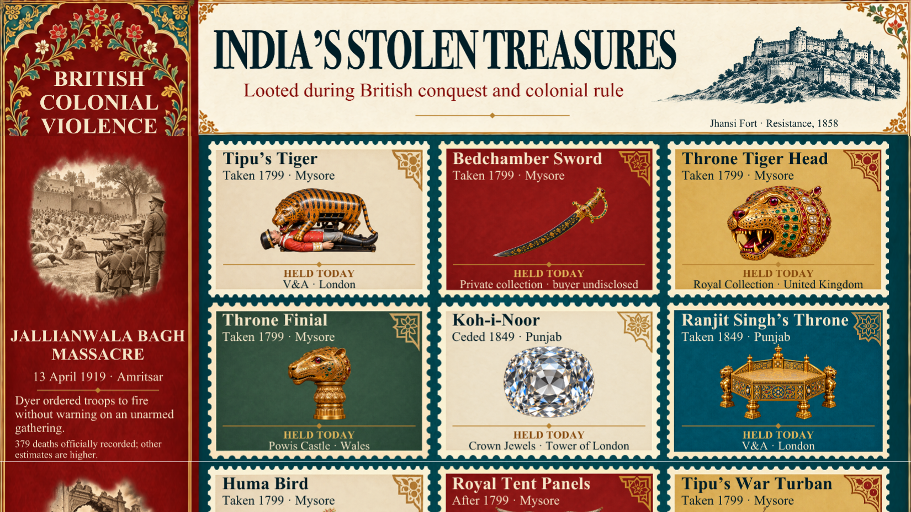

# India’s Stolen Treasures

**A Tableau storytelling project exploring treasures removed from India during British conquest and colonial rule.**

Where did these objects come from, how were they taken, and where are they held today? This dashboard follows selected jewels, weapons, manuscripts and royal possessions, alongside the history of colonial violence and resistance.

This time, my goal was to explore how creative I could be with Tableau—using it as a canvas for history and visual storytelling.

**[Explore the live dashboard](https://public.tableau.com/app/profile/shashank.pabitwar/viz/Indiasstolentreasures/IndiasStolenTreasuresScroll)** · **[Download the Tableau workbook](tableau/Indias-Stolen-Treasures.twbx)**

## What you can explore

- **48 illustrated stamp entries** with removal details and recorded holders.
- Historical stories connecting the objects to conquest, violence and resistance.
- A continuous scrolling layout with Indian-inspired ornament, illustrated scenes and stamp hover information.
- Links to museum collections, archives and further reading.

## How the project came together

I researched collection records and historical sources, organized the selected objects into a catalogue, and designed a continuous Tableau story. Python helped prepare the content and artwork. Floating image components create the visual layout, while Tableau worksheets provide the stamp tooltip layer.

## Files

- [Tableau workbook](tableau/Indias-Stolen-Treasures.twbx) — the packaged workbook downloaded from the published dashboard.
- [Object catalogue](data/treasures.csv) — the 48 selected entries and their source links.
- [Sources and historical notes](SOURCES.md) — provenance, qualifications and further reading.

Open the `.twbx` in Tableau Desktop or Tableau Public. The workbook includes its data and artwork. Individual layout components can be moved, and worksheet tooltips can be edited; text inside the illustrations is embedded in the artwork.

## About the history and artwork

This is a selected collection, not a complete inventory or a monetary estimate of everything removed from India. Terms such as *reported*, *attributed*, *likely* and *ceded* preserve differences in the evidence. Recorded holders do not necessarily indicate public display, and some private locations are unknown.

The generated illustrations are artistic interpretations, not documentary photographs or evidence of an object’s exact appearance. Consult the linked institutional records for the historical evidence.

**Tools:** Tableau · Python · Visual storytelling  
**Built by Shashank Pabitwar.**
